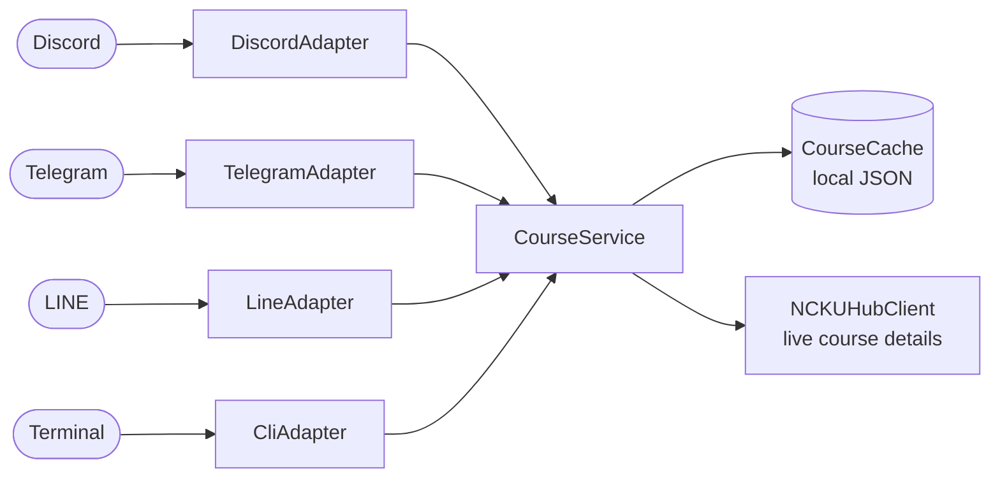

# campus-course-bot 🎓

[](https://github.com/kiresakura/campus-course-bot/actions/workflows/ci.yml)

[](LICENSE)

English | [繁體中文](README.zh-TW.md)

**One platform-agnostic core serves Discord, Telegram and LINE at the same time — adding another
chat platform only takes one thin adapter.**

A course-review bot for students: search courses by keyword, look up an instructor, rank courses
by sweetness (grading) or easiness (workload), compare two courses head to head, and read
comments — all from the chat app you already use.

---

## ⚠️ Disclaimer

**This is an unofficial project and is not affiliated with, endorsed by, or connected to the
NCKUHUB platform or National Cheng Kung University (NCKU).**
本專案為非官方作品,與 NCKUHUB 平台及國立成功大學(NCKU)無任何隸屬、合作或背書關係。

- Course data comes from NCKUHUB's public course pages. This project does **not** bundle or
  redistribute any scraped dataset — you build your own local cache (see below). The only bundled
  course data is the clearly labelled **fictional** demo set in `examples/`.
- Ratings (sweetness / easiness / takeaway) and "worst courses" are **other people's subjective
  opinions**, provided for reference only. They are not facts and are not a judgement of any
  instructor or course.
- Before deploying, make sure you comply with the data source's terms of service and your local
  laws (personal data, copyright, defamation, etc.). See [PRIVACY.md](PRIVACY.md).

---

## ▶️ Try it in a minute (offline demo)

No chat-platform account, no token, no scraping: the demo runs in your terminal on a small
fictional dataset that ships with the repo.

```bash
git clone https://github.com/kiresakura/campus-course-bot.git
cd campus-course-bot
python -m venv .venv && source .venv/bin/activate   # Windows: .venv\Scripts\activate
pip install -r requirements.txt
python src/run.py --platform cli --demo
```

Type a command (English alias or the original Chinese name) and the bot answers with the same
text the chat platforms receive:

```text
> search time
**🔍 搜尋結果：time**
找到 2 門課程

**1. 時光旅行倫理學 Ethics of Time Travel**
👨‍🏫 Chrono ｜ 時空工程系 TIME
🍬 `7.4` 🛋️ `6.1` 📖 `8.8` ｜ 👥 19
📋 `/詳細 103`

**2. 平行宇宙統計學 Multiverse Statistics**
👨‍🏫 Chrono ｜ 時空工程系 TIME
🍬 `3.1` 🛋️ `2.4` 📖 `7.9` ｜ 👥 11
📋 `/詳細 104`

> compare dragon unicorn
**⚔️ 課程 PK**
...
**📊 結果**
🏆 **獨角獸行為觀察 Unicorn Behavior Lab** 勝出！
```

Also try `professor Ember`, `sweet`, `cold 鍊金`, `worst 3`, `detail 101`; `quit` or Ctrl-D exits.
Commands can be piped too: `printf 'sweet\nworst 3\n' | python src/run.py --platform cli --demo`.

About the demo data: `--demo` loads [`examples/fictional_courses.json`](examples/fictional_courses.json)
— twelve invented courses, departments, instructors, ratings and comments. It is not scraped and
describes no real course or person. Course details are read from that file, so the demo never
touches the network. `--demo` only swaps the data source, so it can be combined with any platform.

## ✨ Commands

| Command (Discord / LINE) | Alias (Telegram / terminal) | What it does |
|---|---|---|
| `課程 <keyword>` | `search` | Search by course name, instructor or department |
| `教授 <name>` | `professor` | Average ratings across an instructor's courses |
| `甜課 [dept]` | `sweet` | Top 10 by sweetness (grading), optionally within one department |
| `涼課 [dept]` | `cold` | Top 10 by easiness (workload) |
| `比較 <A> <B>` | `compare` | Head-to-head comparison of two courses |
| `雷課 [n]` | `worst` | Lowest-rated courses with at least 3 ratings (subjective, reference only) |
| `詳細 <id>` | `detail` | Course card plus up to three comments, fetched live |

Discord exposes these as slash commands (`/課程`); on LINE they are typed as plain text
(`課程 微積分`). Command names are in Chinese because the bot serves a Chinese-speaking campus
audience; Telegram command names may only use Latin letters, digits and underscores, so Telegram
uses the English aliases (the terminal accepts both).

## 🧩 Architecture: one core, many platforms



`CourseService` holds all command logic and returns a platform-neutral `BotResponse` (title,
description, fields, footer, semantic style). Each adapter only maps platform input to a service
call and renders that `BotResponse` in its own format — a Discord embed, Telegram HTML, LINE plain
text or terminal Markdown. The core never imports a chat SDK, and every adapter lazy-imports its
own, so the platforms you do not use need nothing installed.

```
src/
├── core/                    # Platform-agnostic core (no chat-platform SDK)
│   ├── models.py            #   Course + neutral response model (BotResponse)
│   ├── cache.py             #   Local cache & queries (thefuzz optional)
│   ├── course_service.py    #   All command logic → returns BotResponse
│   ├── nckuhub_client.py    #   Data fetching (User-Agent + backoff)
│   └── demo.py              #   --demo: fictional dataset + offline details
├── adapters/                # One thin adapter per platform
│   ├── base.py              #   BotAdapter interface + shared command aliases
│   ├── discord_adapter.py   #   Discord (slash commands)
│   ├── telegram_adapter.py  #   Telegram (polling)
│   ├── line_adapter.py      #   LINE (webhook)
│   └── cli_adapter.py       #   Terminal (stdin/stdout)
└── run.py                   # Entrypoint; picks a platform via BOT_PLATFORM / --platform
```

**Adding a platform** = subclass `BotAdapter` and implement `render(BotResponse)` and `start()`;
all the core logic is reused. [`cli_adapter.py`](src/adapters/cli_adapter.py) is a complete
example in under 70 lines.

| Platform | Transport | Extra install | Settings |
|---|---|---|---|
| Discord | Slash commands | — (`discord.py` is in requirements) | `DISCORD_TOKEN`, optional `GUILD_ID` |
| Telegram | Long polling | `pip install python-telegram-bot==21.4` | `TELEGRAM_BOT_TOKEN` |
| LINE | Webhook (public HTTPS) | — (built on `aiohttp`) | `LINE_CHANNEL_ACCESS_TOKEN`, `LINE_CHANNEL_SECRET`, `PORT` |
| Terminal | stdin / stdout | — | — |

## 🚀 Deploying on a chat platform

```bash
pip install -r requirements.txt
cp .env.example .env       # pick BOT_PLATFORM and fill in that platform's settings
python build_cache.py      # build your own local course cache (see below)
python src/run.py          # or override: python src/run.py --platform telegram
```

`BOT_PLATFORM` (or `--platform`) selects `discord` (default), `telegram`, `line` or `cli`. Settings
are read from the environment or `.env` — see [`.env.example`](.env.example).

### Discord

1. Create an application in the [Discord Developer Portal](https://discord.com/developers/applications);
   under **Bot**, copy the token into `DISCORD_TOKEN`.
2. Under **OAuth2 → URL Generator**, select the scopes `bot` and `applications.commands`, then open
   the generated URL to invite the bot to your server.
3. Optional during development: set `GUILD_ID` to your test server's ID to sync the slash commands to
   that server only, which is faster than a global sync.
4. Run `BOT_PLATFORM=discord python src/run.py`.

No privileged intents are needed: the bot uses slash commands only and never reads ordinary messages.

### Telegram

1. Message [@BotFather](https://t.me/BotFather), run `/newbot`, and put the token in `TELEGRAM_BOT_TOKEN`.
2. `pip install python-telegram-bot==21.4`
3. Run `BOT_PLATFORM=telegram python src/run.py` — long polling, so no public URL is needed.

Users send `/search 微積分`, `/compare A B`, … and `/help` for usage. Long replies are split to
fit Telegram's 4096-character limit.

### LINE

1. In the [LINE Developers Console](https://developers.line.biz/console/), create a **Messaging API**
   channel.
2. Copy the channel secret into `LINE_CHANNEL_SECRET` and issue a channel access token for
   `LINE_CHANNEL_ACCESS_TOKEN`.
3. Run `BOT_PLATFORM=line PORT=8000 python src/run.py`. This serves `POST /callback` (every request
   must carry a valid `X-Line-Signature` HMAC; others get `403`) and `GET /health`.
4. Expose the server over HTTPS (a reverse proxy or a platform such as Railway), set the webhook URL
   to `https://<your-domain>/callback`, and turn on **Use webhook**.

Users send plain messages such as `課程 微積分` or `詳細 1234`; anything else gets the command list.

### Hosting

`railway.json` and a `Procfile` are included; both start `python src/run.py`, so set
`BOT_PLATFORM` and that platform's variables in your service settings. The course cache is never
committed, so a fresh deployment starts empty: build it on the host (for example on a persistent
volume mounted at `data/`) before serving real data.

## 🗃️ Build your own cache (important)

This project does **not** ship a real course dataset. Run `python build_cache.py` to generate
`data/course_cache.json` locally (it is `.gitignore`d and never committed).

> Please be respectful to the data source: `core/nckuhub_client.py` already sets an identifying
> User-Agent, limits concurrency, and backs off between requests. Do not remove these courtesy
> measures, and **do not redistribute** the scraped data.

## 🧪 Tests & CI

```bash
pip install pytest
pytest -q
```

The suite needs no tokens and no internet access. It covers the core (search, instructor lookup,
rankings, comparison, course details, the response model), every adapter's rendering, command
routing for Telegram, LINE and the terminal, LINE signature verification plus a webhook round trip
against a local test server, and the offline demo end to end. [GitHub Actions](.github/workflows/ci.yml) runs it on Python 3.10,
3.11 and 3.12 for every push and pull request to `main`.

## 🔧 Tech stack

- Python 3.10+
- discord.py 2.x (default adapter)
- aiohttp (async HTTP; also powers the LINE webhook server)
- thefuzz (optional fuzzy search; falls back to exact matching when absent)
- pytest (tests)

## 🔒 Security & privacy

- Vulnerability reporting: see [SECURITY.md](SECURITY.md)
- Privacy notes (data provenance, what the bot reads): see [PRIVACY.md](PRIVACY.md)

## 📜 License

[MIT License](LICENSE) © 2026 Crimson
