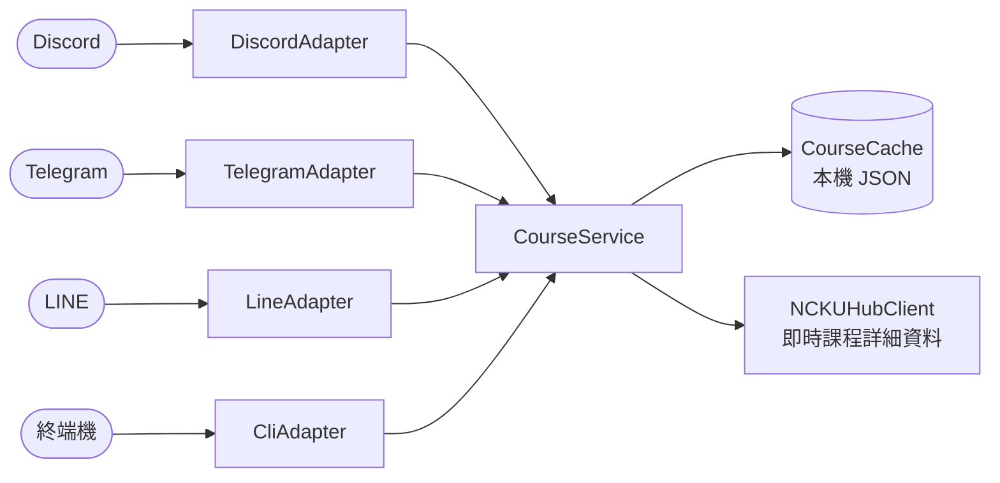

# campus-course-bot 🎓

[](https://github.com/kiresakura/campus-course-bot/actions/workflows/ci.yml)

[](LICENSE)

[English](README.md) | 繁體中文

**一套與平台無關的核心，同時服務 Discord、Telegram、LINE 三個聊天平台；要接新平台，只需再寫一層薄薄的 adapter。**

給學生用的課程評價查詢機器人：用關鍵字搜尋課程、查教授、依甜度（給分）或涼度（負擔）排行、兩門課正面對決、看修課心得——在你本來就在用的聊天軟體裡完成。

---

## ⚠️ 免責聲明

**本專案為非官方作品，與 NCKUHUB 平台及國立成功大學（NCKU）無任何隸屬、合作或背書關係。**
This is an unofficial project and is not affiliated with, endorsed by, or connected to the NCKUHUB
platform or National Cheng Kung University (NCKU).

- 課程資料來自 NCKUHUB 的公開課程頁面。本專案**不附帶、也不散布**任何爬取的資料集——請自行在本機建立快取（見下文）。repo 內唯一的課程資料，是 `examples/` 裡明確標示為**虛構**的示範資料。
- 甜度、涼度、收穫等評分與「雷課」都是**他人的主觀意見**，僅供參考，不是事實，也不代表對任何教師或課程的評價。
- 部署前請確認遵守資料來源的服務條款與當地法律（個人資料、著作權、誹謗等）。詳見 [PRIVACY.md](PRIVACY.md)。

---

## ▶️ 一分鐘試玩（離線示範模式）

不需要任何聊天平台帳號、不需要 token、不需要爬資料：示範模式在終端機裡執行，使用 repo 內附的一小份虛構資料。

```bash
git clone https://github.com/kiresakura/campus-course-bot.git
cd campus-course-bot
python -m venv .venv && source .venv/bin/activate   # Windows：.venv\Scripts\activate
pip install -r requirements.txt
python src/run.py --platform cli --demo
```

輸入指令（英文別名或原本的中文指令名皆可），機器人回覆的文字與各聊天平台收到的內容相同：

```text
> search time
**🔍 搜尋結果：time**
找到 2 門課程

**1. 時光旅行倫理學 Ethics of Time Travel**
👨‍🏫 Chrono ｜ 時空工程系 TIME
🍬 `7.4` 🛋️ `6.1` 📖 `8.8` ｜ 👥 19
📋 `/詳細 103`

**2. 平行宇宙統計學 Multiverse Statistics**
👨‍🏫 Chrono ｜ 時空工程系 TIME
🍬 `3.1` 🛋️ `2.4` 📖 `7.9` ｜ 👥 11
📋 `/詳細 104`

> 比較 dragon unicorn
**⚔️ 課程 PK**
...
**📊 結果**
🏆 **獨角獸行為觀察 Unicorn Behavior Lab** 勝出！
```

也可以試試 `教授 Ember`、`甜課`、`涼課 鍊金`、`雷課 3`、`詳細 101`；輸入 `quit` 或按 Ctrl-D 離開。
也能用管線一次送多個指令：`printf 'sweet\nworst 3\n' | python src/run.py --platform cli --demo`。

關於示範資料：`--demo` 會載入 [`examples/fictional_courses.json`](examples/fictional_courses.json)——十二門虛構的課程，連同系所、教師、評分與心得全部是杜撰的，不是爬取資料，也不對應任何真實課程或人物。課程詳細資料直接從這個檔案讀取，所以示範模式完全不連網。`--demo` 只替換資料來源，因此可以搭配任何平台使用。

## ✨ 指令

| 指令（Discord / LINE） | 別名（Telegram / 終端機） | 功能 |
|---|---|---|
| `課程 <關鍵字>` | `search` | 依課名、教師或系所搜尋 |
| `教授 <姓名>` | `professor` | 該教師所有課程的平均評分 |
| `甜課 [系所]` | `sweet` | 甜度（給分）前 10 名，可限定系所 |
| `涼課 [系所]` | `cold` | 涼度（負擔）前 10 名 |
| `比較 <A> <B>` | `compare` | 兩門課正面對決 |
| `雷課 [n]` | `worst` | 至少 3 則評分中分數最低的課程（主觀，僅供參考） |
| `詳細 <id>` | `detail` | 課程卡片加最多三則心得，即時抓取 |

Discord 上是斜線指令（`/課程`）；LINE 上直接輸入文字（`課程 微積分`）。指令名稱用中文，是因為服務對象是中文校園；Telegram 的指令名稱只能用拉丁字母、數字與底線，所以 Telegram 使用英文別名（終端機兩種都接受）。

## 🧩 架構：一套核心，多個平台



`CourseService` 負責所有指令邏輯，回傳與平台無關的 `BotResponse`（標題、描述、欄位、頁尾、語意樣式）。每個 adapter 只做兩件事：把平台的輸入轉成一次 service 呼叫，再把 `BotResponse` 轉成自己平台的格式——Discord embed、Telegram HTML、LINE 純文字或終端機 Markdown。核心從不 import 任何聊天 SDK，各 adapter 也都延遲載入自己的 SDK，沒用到的平台什麼都不必安裝。

```
src/
├── core/                    # 與平台無關的核心（不依賴任何聊天平台 SDK）
│   ├── models.py            #   Course 與中立回應模型（BotResponse）
│   ├── cache.py             #   本機快取與查詢（thefuzz 為選用）
│   ├── course_service.py    #   全部指令邏輯 → 回傳 BotResponse
│   ├── nckuhub_client.py    #   資料抓取（User-Agent + 退避）
│   └── demo.py              #   --demo：虛構資料集＋離線詳細資料
├── adapters/                # 每個平台一層薄 adapter
│   ├── base.py              #   BotAdapter 介面＋共用的指令別名
│   ├── discord_adapter.py   #   Discord（斜線指令）
│   ├── telegram_adapter.py  #   Telegram（polling）
│   ├── line_adapter.py      #   LINE（webhook）
│   └── cli_adapter.py       #   終端機（stdin/stdout）
└── run.py                   # 進入點；依 BOT_PLATFORM / --platform 選擇平台
```

**新增平台**＝繼承 `BotAdapter`，實作 `render(BotResponse)` 與 `start()`；核心邏輯全部沿用。[`cli_adapter.py`](src/adapters/cli_adapter.py) 就是一個不到 70 行的完整範例。

| 平台 | 傳輸方式 | 額外安裝 | 設定 |
|---|---|---|---|
| Discord | 斜線指令 | 無（`discord.py` 已在 requirements） | `DISCORD_TOKEN`，可選 `GUILD_ID` |
| Telegram | Long polling | `pip install python-telegram-bot==21.4` | `TELEGRAM_BOT_TOKEN` |
| LINE | Webhook（需公開 HTTPS） | 無（以 `aiohttp` 實作） | `LINE_CHANNEL_ACCESS_TOKEN`、`LINE_CHANNEL_SECRET`、`PORT` |
| 終端機 | stdin / stdout | 無 | 無 |

## 🚀 部署到聊天平台

```bash
pip install -r requirements.txt
cp .env.example .env       # 選擇 BOT_PLATFORM 並填入該平台的設定
python build_cache.py      # 自行建立本機課程快取（見下文）
python src/run.py          # 或覆寫平台：python src/run.py --platform telegram
```

`BOT_PLATFORM`（或 `--platform`）可選 `discord`（預設）、`telegram`、`line`、`cli`。設定值從環境變數或 `.env` 讀取，見 [`.env.example`](.env.example)。

### Discord

1. 在 [Discord Developer Portal](https://discord.com/developers/applications) 建立 application，於 **Bot** 頁複製 token 填入 `DISCORD_TOKEN`。
2. 在 **OAuth2 → URL Generator** 勾選 `bot` 與 `applications.commands` 兩個 scope，開啟產生的網址把機器人邀進伺服器。
3. 開發期間可選：把 `GUILD_ID` 設為測試伺服器 ID，斜線指令只同步到該伺服器，比全域同步快。
4. 執行 `BOT_PLATFORM=discord python src/run.py`。

不需要任何 privileged intent：機器人只用斜線指令，不讀一般訊息。

### Telegram

1. 私訊 [@BotFather](https://t.me/BotFather)，執行 `/newbot`，把 token 填入 `TELEGRAM_BOT_TOKEN`。
2. `pip install python-telegram-bot==21.4`
3. 執行 `BOT_PLATFORM=telegram python src/run.py`——使用 long polling，不需要公開網址。

使用者輸入 `/search 微積分`、`/compare A B` 等，`/help` 顯示用法。過長的回覆會自動切段，符合 Telegram 4096 字元上限。

### LINE

1. 在 [LINE Developers Console](https://developers.line.biz/console/) 建立 **Messaging API** channel。
2. 把 channel secret 填入 `LINE_CHANNEL_SECRET`，並發行 channel access token 填入 `LINE_CHANNEL_ACCESS_TOKEN`。
3. 執行 `BOT_PLATFORM=line PORT=8000 python src/run.py`，會提供 `POST /callback`（每個請求都必須帶有效的 `X-Line-Signature` HMAC，否則回 `403`）與 `GET /health`。
4. 用 HTTPS 對外公開（反向代理或 Railway 等平台），把 webhook URL 設為 `https://<你的網域>/callback`，並開啟 **Use webhook**。

使用者直接傳文字訊息，例如 `課程 微積分` 或 `詳細 1234`；其他內容會收到指令清單。

### 託管

repo 已附 `railway.json` 與 `Procfile`，兩者都執行 `python src/run.py`；請在服務設定中填入 `BOT_PLATFORM` 與該平台的變數。課程快取永遠不會進版控，所以全新部署時快取是空的：請在主機上建立快取（例如放在掛載到 `data/` 的持久化 volume）後再提供真實資料。

## 🗃️ 自行建立快取（重要）

本專案**不**附帶真實課程資料集。執行 `python build_cache.py` 會在本機產生 `data/course_cache.json`（已列入 `.gitignore`，絕不提交）。

> 請尊重資料來源：`core/nckuhub_client.py` 已設定可識別的 User-Agent、限制併發數，並在請求之間退避。請勿移除這些禮貌措施，也**請勿散布**爬取到的資料。

## 🧪 測試與 CI

```bash
pip install pytest
pytest -q
```

整套測試不需要任何 token，也不連網際網路。涵蓋核心（搜尋、查教授、排行、比較、課程詳細資料、回應模型）、每個 adapter 的呈現、Telegram／LINE／終端機的指令分派、LINE 簽章驗證與對本機測試伺服器的 webhook 往返，以及離線示範模式的端到端流程。[GitHub Actions](.github/workflows/ci.yml) 會在每次 push 到 `main`、以及每個對 `main` 的 pull request 時，以 Python 3.10、3.11、3.12 執行。

## 🔧 技術棧

- Python 3.10+
- discord.py 2.x（預設 adapter）
- aiohttp（非同步 HTTP；也是 LINE webhook 伺服器的基礎）
- thefuzz（選用的模糊搜尋；未安裝時改用精確比對）
- pytest（測試）

## 🔒 安全與隱私

- 回報漏洞：見 [SECURITY.md](SECURITY.md)
- 隱私說明（資料來源、機器人會讀取什麼）：見 [PRIVACY.md](PRIVACY.md)

## 📜 授權

[MIT License](LICENSE) © 2026 Crimson
